<div align="center">

# ⚡ Multi-Domain Digital Signal Processing Studio
### *Mathematical Signals · Speech Analysis · Audio Filtering · 2D Image Fourier · Denoising*

[](https://www.python.org/)
[](https://numpy.org/)
[](https://scipy.org/)
[](https://opencv.org/)
[](https://flask.palletsprojects.com/)
[]()

[**Interactive Web Studio**](#-interactive-web-studio) •
[**Modules & Visual Outputs**](#-modules--visual-outputs) •
[**Quick Start**](#-quick-start) •
[**CLI Execution**](#-command-line-interface) •
[**Team**](#-project-team)

---

</div>

## 📌 Executive Summary

This repository contains an end-to-end, multi-domain **Digital Signal Processing (DSP)** laboratory and research suite. Spanning 1D synthetic signals, real human speech acoustics, and 2D spatial frequencies in digital images, the project covers fundamental signal processing principles, mathematical verification, and interactive frequency-domain filtering.

The suite includes both a **deterministic CLI batch-processing pipeline** and an **interactive, dark-themed scientific Web Dashboard (`DSP LAB`)** that enables real-time parameter experimentation, pipeline execution tracking, and instant visual verification without modifying underlying algorithms.

---

## 🚀 Interactive Web Studio

The project includes **DSP LAB**, a web-based scientific exploration studio running directly against the Python DSP backend.

```bash
python app.py
# Open http://localhost:5000 in your browser
```

### Studio Capabilities
- **One-Click Pipeline**: Run all six DSP experiments sequentially with live execution progress and captured logs.
- **Independent Part Execution**: Execute isolated modules on-demand without reprocessing unchanged stages.
- **Live Parameter Controls**: Sliders, inputs, and interactive widgets to alter frequencies, window sizes, filter poles, radii, and noise amplitudes.
- **Zero-Drift Defaults**: Instant reset back to the verified academic baseline defaults.
- **Audio & Visual Inspection**: Inline playback for clean, noisy, and filtered WAVs alongside side-by-side high-resolution spectral plots and image masks.
- **Experiment Management**: Store, label, and compare metrics (SNR, MSE, PSNR, attenuation dB) across runs.

---

## 🔬 Modules & Visual Outputs

```
DSP Project Pipeline
├── Part 1: Discrete-Time Fourier Transform (DTFT)
├── Part 2: Convolution, Circular Aliasing & Difference Equations
├── Part 3: Speech Acoustics, STFT Spectrogram & Mains Hum
├── Part 4: Second-Order IIR Notch Filter & Stability Analysis
├── Part 5: 2D Spatial DFT, Circular Low-Pass / High-Pass Filtering
└── Part 6: Periodic Noise Notch Denoising, PSNR & MSE Evaluation
```

---

### Part 1 — Mathematical Signal & Discrete-Time Fourier Transform (DTFT)

#### 🎯 Objective & Theory
Compute the DTFT directly from its mathematical definition using loops to demonstrate how continuous frequency representations emerge from discrete-time series:
$$X(\omega) = \sum_{n=0}^{N-1} x[n] e^{-j\omega n}, \quad \omega \in [-\pi, \pi]$$
A composite signal $x[n] = A_1 \sin(2\pi F_1 n / F_s) + A_2 \sin(2\pi F_2 n / F_s) + w[n]$ ($F_1 = 100\text{ Hz}, F_2 = 250\text{ Hz}, F_s = 1000\text{ Hz}, N = 64$) is evaluated across 512 normalized frequency points.

#### 📊 Visual Outputs

| 1. Time-Domain Signal | 2. DTFT Magnitude & Phase Spectrum |
| :---: | :---: |
| 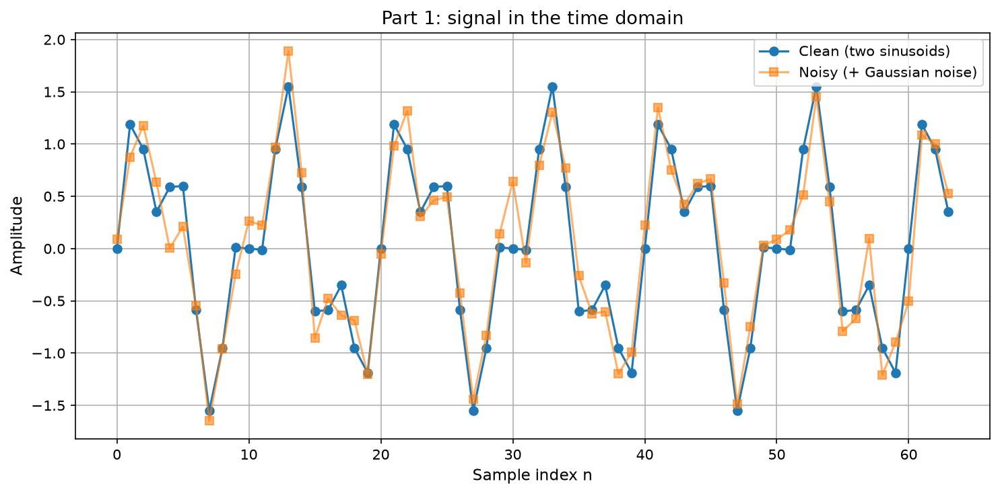 | 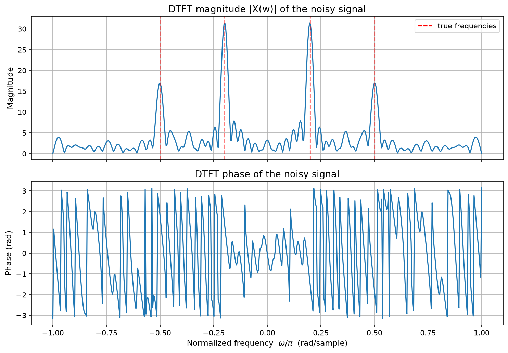 |
| *Composite dual-tone signal embedded in Gaussian noise ($\sigma=0.3$)* | *Symmetric spectral peaks at $\omega/\pi = \pm 0.2$ ($100\text{ Hz}$) and $\pm 0.5$ ($250\text{ Hz}$)* |

<div align="center">

| 3. Effect of Sample Length $N$ on Spectral Resolution |
| :---: |
| 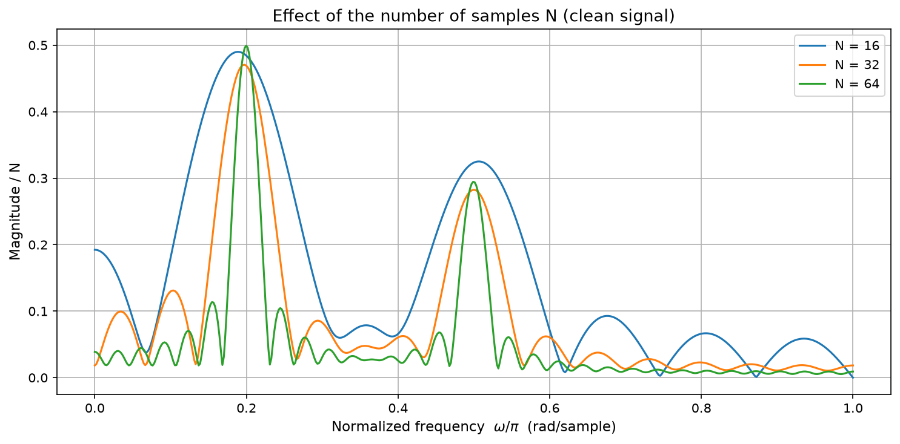 |
| *Spectral leakage narrows and peak resolution sharpens dramatically as $N$ scales from 16 to 64* |

</div>

- **Peak Identification**: Detected peaks at **99.6 Hz** and **251.0 Hz** (true: 100 Hz & 250 Hz, within grid resolution).
- **FFT Equivalence**: Max numerical error between definition-based loop DTFT and `np.fft.fft` is $\mathbf{< 3.5 \times 10^{-15}}$, proving the FFT is an exact sampling of the DTFT at $\omega_k = \frac{2\pi k}{N}$.

---

### Part 2 — Convolution & Difference Equations

#### 🎯 Objective & Theory
1. Implement a moving-average FIR smoothing filter: $h[n] = \frac{1}{M}\sum_{k=0}^{M-1}\delta[n-k]$.
2. Demonstrate the **Convolution Theorem** in discrete time:
   $$y[n] = x[n] * h[n] \iff Y(\omega) = X(\omega)H(\omega)$$
   Verify that zero-padding to $L \ge N + M - 1$ produces exact linear convolution, whereas unpadded DFT multiplication causes circular time-aliasing wrap-around error.
3. Solve a recursive first-order difference equation $y[n] = a \cdot y[n-1] + x[n]$ and explore impulse response stability ($|a| < 1$ vs. $|a| > 1$).

#### 📊 Visual Outputs

| 1. Moving Average Smoothing Across Windows $M \in \{3, 5, 11\}$ | 2. Time vs. Frequency Domain Equivalence & Aliasing |
| :---: | :---: |
| 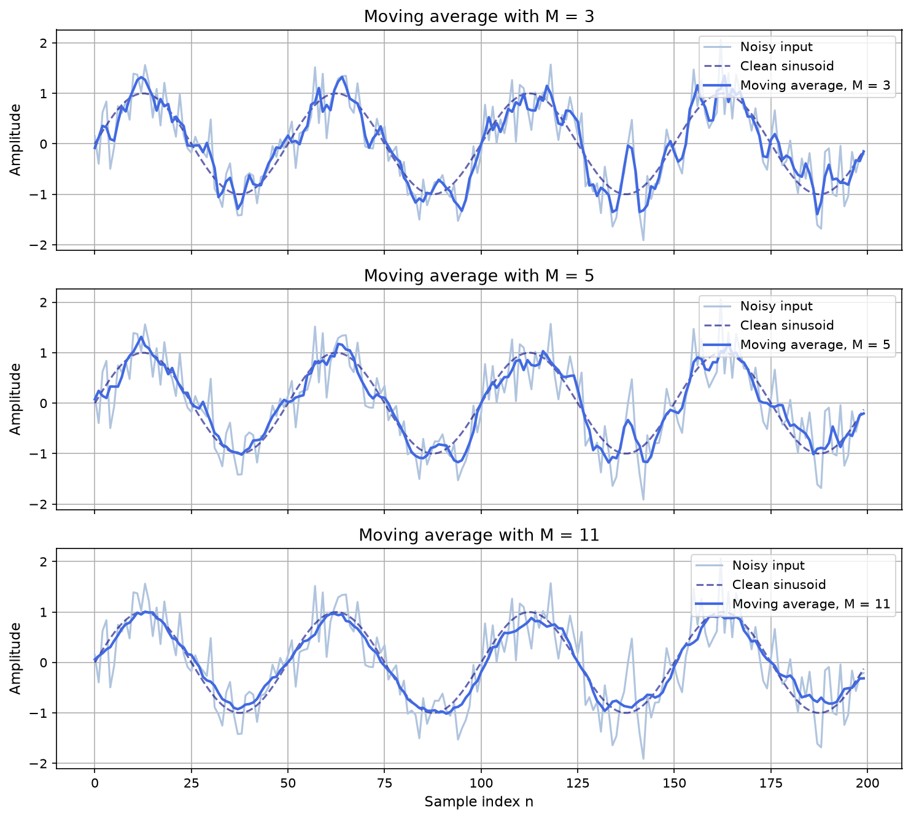 | 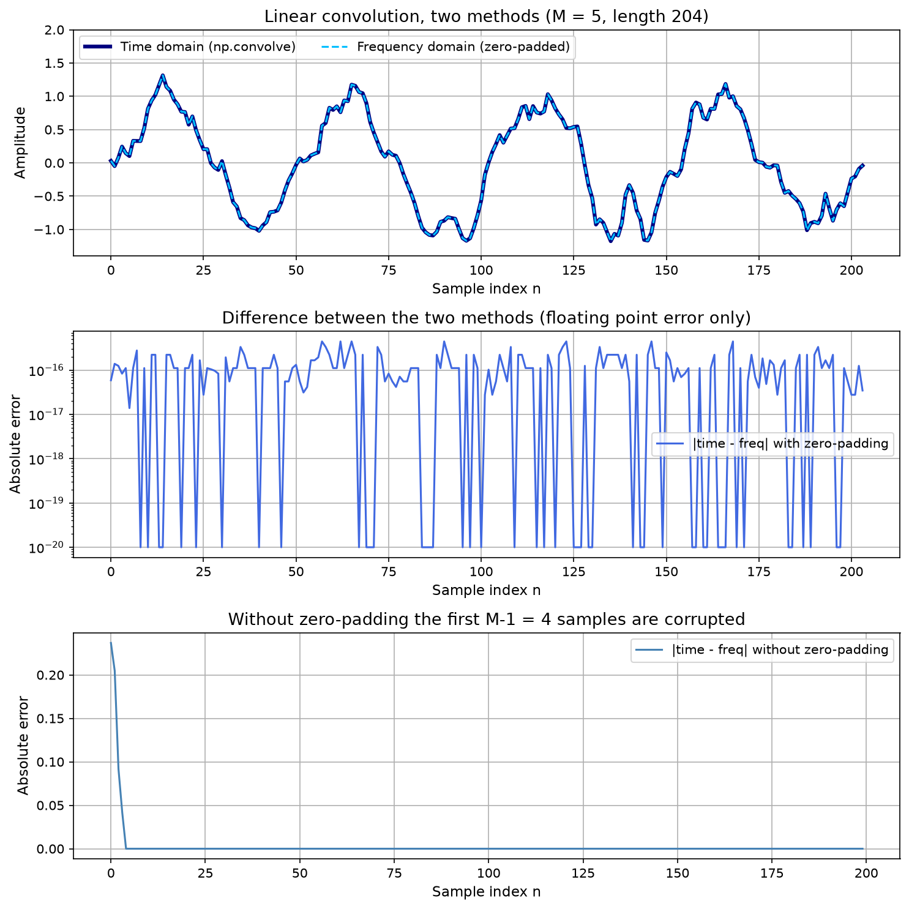 |
| *Increasing $M$ suppresses high-frequency noise at the cost of transient group delay* | *Linear zero-padded error is $\approx 10^{-16}$; unpadded circular wrap-around corrupts the first $M-1$ samples* |

| 3. FIR Filter Frequency Response $|H(\omega)|$ | 4. First-Order Difference Equation ($a=0.8$ vs. $a=1.2$) |
| :---: | :---: |
| 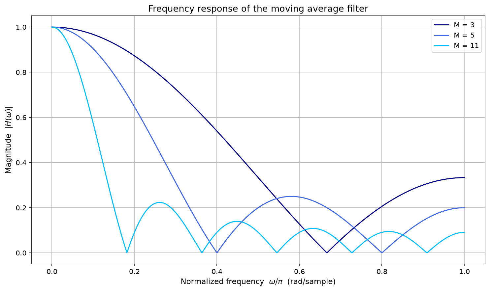 | 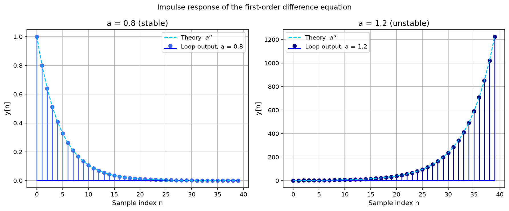 |
| *Sinc-like attenuation with spectral nulls at multiples of $\omega = 2\pi/M$* | *BIBO stable decaying exponential $0.8^n$ vs. unstable exploding exponential $1.2^n$* |

---

### Part 3 — Audio Signal Analysis & Mains Interference

#### 🎯 Objective & Theory
Analyze real acoustic human speech (`data/speech.wav`), examine its temporal envelope, root-mean-square (RMS) energy, single-sided Hann-windowed spectrum, and Short-Time Fourier Transform (STFT) spectrogram. Subsequently inject realistic mains hum interference at $F_0 = 60\text{ Hz}$ calibrated to a prescribed Signal-to-Interference Ratio:
$$A_{\text{noise}} = \frac{\sqrt{2} \cdot \text{RMS}(x)}{10^{\text{SNR}_{\text{dB}} / 20}}$$

#### 📊 Visual Outputs

| 1. Speech Waveform in Time Domain | 2. Hann-Windowed Magnitude Spectrum |
| :---: | :---: |
|  |  |
| *Full speech recording envelope normalized to $[-1, 1]$* | *Log-frequency spectrum showing 95% spectral energy boundary* |

| 3. Clean Speech Spectrogram (STFT) | 4. Clean vs. Hum-Corrupted Spectrum & Time Zoom |
| :---: | :---: |
|  |  |
| *Time-frequency articulation using 25 ms Hann window with 10 ms hop size* | *Pronounced $60\text{ Hz}$ tonal spike and periodic distortion in temporal zoom* |

<div align="center">

| 5. Spectrogram Resolution Tradeoff (Short vs. Long Window) |
| :---: |
|  |
| *Heisenberg-Gabor uncertainty: $10\text{ ms}$ window smears spectral resolution; $100\text{ ms}$ window resolves the $60\text{ Hz}$ line cleanly* |

</div>

- **Audio Characteristics**: $F_s = 16{,}000\text{ Hz}$, Duration: 9.22 s, Peak: 0.999, RMS: 0.1035.
- **Interference Injected**: $60\text{ Hz}$ sinusoid at $\text{SNR} = 10\text{ dB}$, producing an isolated $+33.5\text{ dB}$ narrow-band spike.

---

### Part 4 — Audio Filtering with Second-Order IIR Notch Filter

#### 🎯 Objective & Theory
Design and apply a digital second-order Infinite Impulse Response (IIR) notch filter to excise the $60\text{ Hz}$ power-line interference while preserving adjacent speech harmonics:
$$H(z) = K \frac{1 - 2\cos(\omega_0)z^{-1} + z^{-2}}{1 - 2r\cos(\omega_0)z^{-1} + r^2 z^{-2}}$$
where $\omega_0 = 2\pi F_0 / F_s$, $r = 0.999$ defines the sharp $-3\text{ dB}$ Q-factor bandwidth, and $K$ normalizes the gain at Nyquist to $0\text{ dB}$.

#### 📊 Visual Outputs

| 1. Waveform Comparison (Noisy vs. Filtered) | 2. Spectral Attenuation at Notch Center |
| :---: | :---: |
| 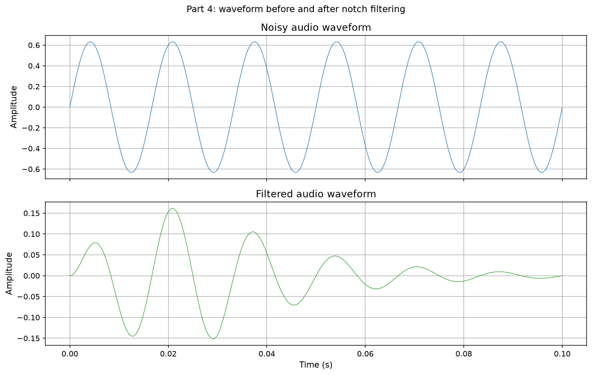 | 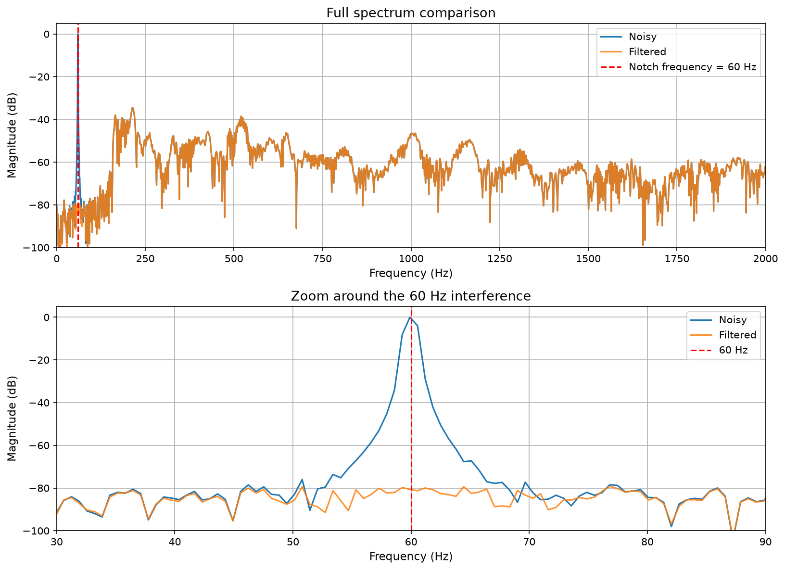 |
| *Removal of continuous baseline hum oscillations in the time domain* | *Narrow null exactly eliminating the $60\text{ Hz}$ spike down to background noise* |

| 3. Notch Frequency Response $|H(f)|$ (dB) | 4. Z-Plane Pole-Zero Constellation & Stability |
| :---: | :---: |
| 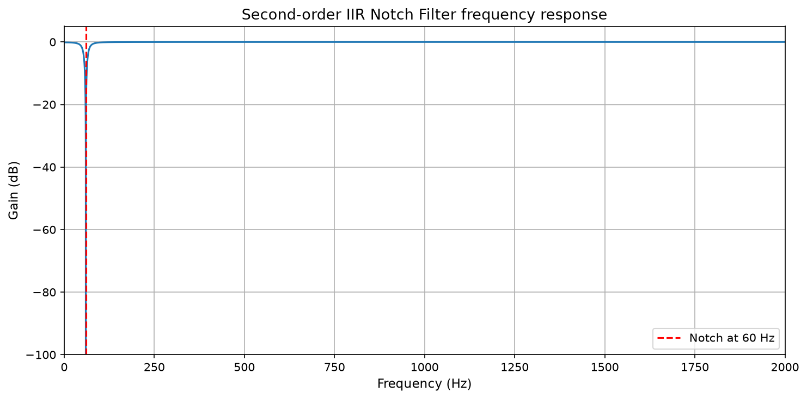 | 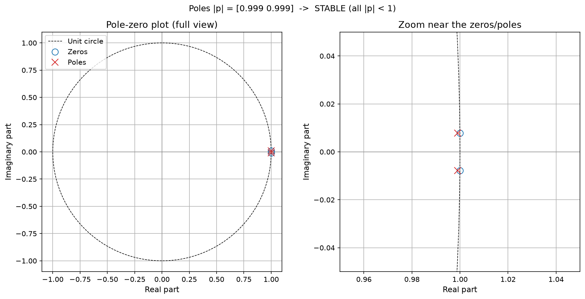 |
| *Ultra-narrow notch centered at $60\text{ Hz}$ with unity passband gain* | *Complex zeros on unit circle $|z|=1$; poles at radius $r=0.999 < 1$ ensuring BIBO stability* |

- **Interference Reduction**: Narrow-band hum reduced by **$> 31.8\text{ dB}$**.
- **Acoustic Quality**: Speech intelligibility fully preserved with edge-click taper smoothing.

---

### Part 5 — 2D Fourier Transform & Spatial Image Filtering

#### 🎯 Objective & Theory
Compute the 2D Discrete Fourier Transform of an image:
$$F(u, v) = \sum_{x=0}^{M-1} \sum_{y=0}^{N-1} f(x, y) e^{-j 2\pi \left(\frac{ux}{M} + \frac{vy}{N}\right)}$$
Apply centered 2D masks ($H(u,v)$) and reconstruct spatial images via 2D inverse DFT:
- **Ideal Low-Pass Filter (ILPF)**: Eliminates high frequencies beyond radius $D_0$, demonstrating ringing artifacts (Gibbs phenomenon).
- **Ideal High-Pass Filter (IHPF)**: Preserves only high spatial frequencies (edges, fine textures).
- **Gaussian Low-Pass Filter (GLPF)**: Smooth transition avoiding spatial ripple artifacts.

#### 📊 Visual Outputs

| 1. Grayscale Image & 2D Centered Log Spectrum | 2. Ideal Low-Pass and High-Pass Masking |
| :---: | :---: |
| 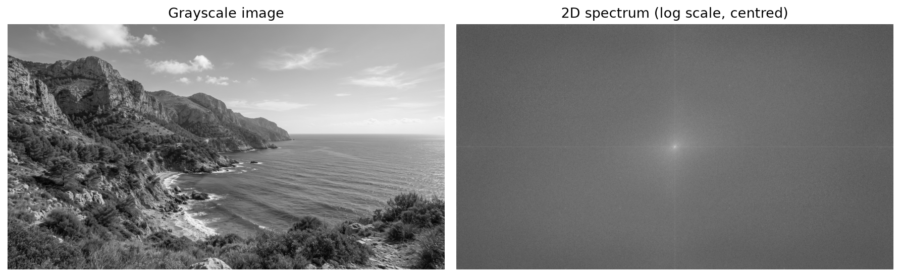 | 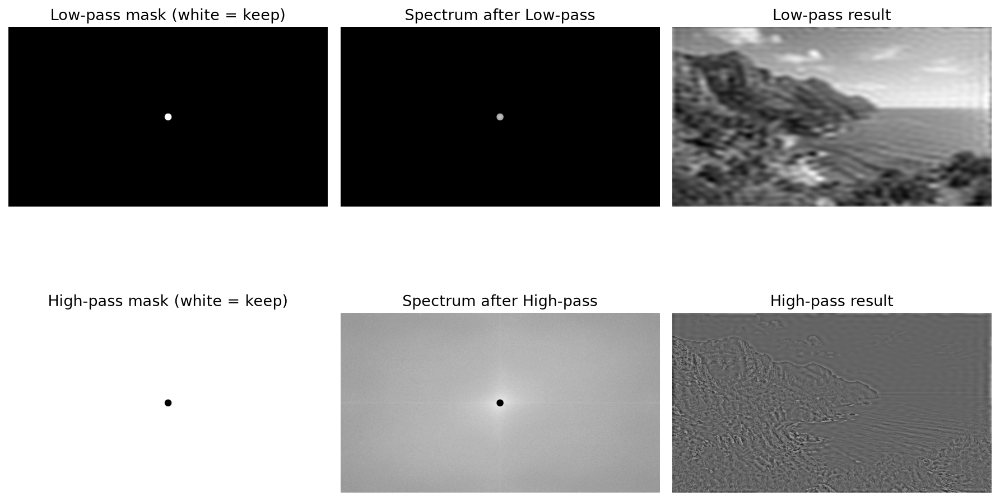 |
| *Spatial domain image alongside centered 2D Fourier magnitude spectrum* | *Binary frequency masks, masked spectra, and spatial reconstructed images* |

| 3. Effect of Filter Radius $D_0 \in \{10, 30, 60\}$ px | 4. Ringing Artifacts: Ideal vs. Gaussian Low-Pass |
| :---: | :---: |
| 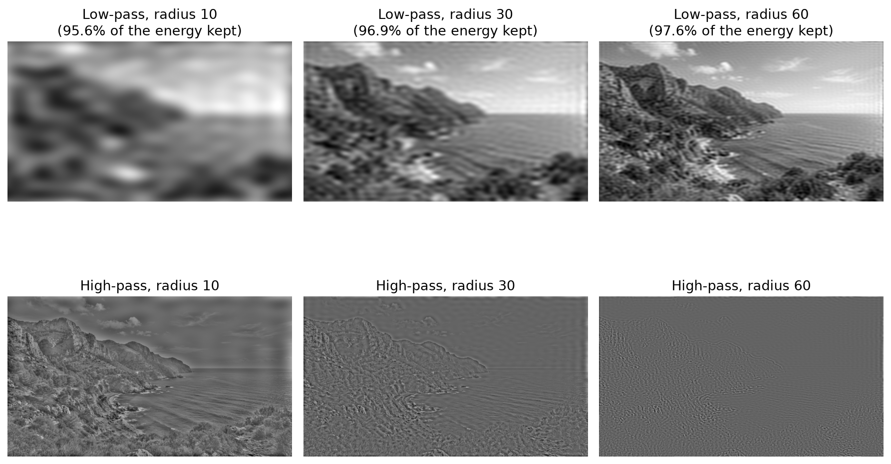 | 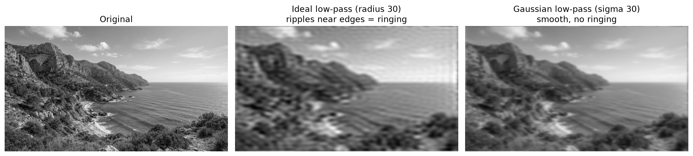 |
| *Energy retention scaling from $94.2\%$ to $99.1\%$ as cutoff radius widens* | *Sharp ideal boundary causes spatial sinc ringing; smooth Gaussian produces pure blur* |

---

### Part 6 — Image Denoising & Evaluation

#### 🎯 Objective & Theory
1. Corrupt a test image with high-amplitude sinusoidal periodic noise:
   $$\eta(x, y) = A \sin\left(2\pi \left(\frac{u_0 x}{W} + \frac{v_0 y}{H}\right)\right)$$
2. The periodic pattern manifests as conjugate impulse spikes in the centered 2D spectrum at $(\pm u_0, \pm v_0)$ relative to the DC center.
3. Construct a 2D spatial-frequency **notch rejection mask** with radius $R$ around both points.
4. Reconstruct the image and quantify restoration performance using **Mean Squared Error (MSE)** and **Peak Signal-to-Noise Ratio (PSNR)**:
   $$\text{MSE} = \frac{1}{MN}\sum_{x,y} [f(x,y) - \hat{f}(x,y)]^2, \quad \text{PSNR} = 10 \log_{10}\left(\frac{255^2}{\text{MSE}}\right)$$

#### 📊 Visual Outputs

| 1. Periodic Corruption & Noise Impulses | 2. 2D Notch Filter Rejection Mask |
| :---: | :---: |
| 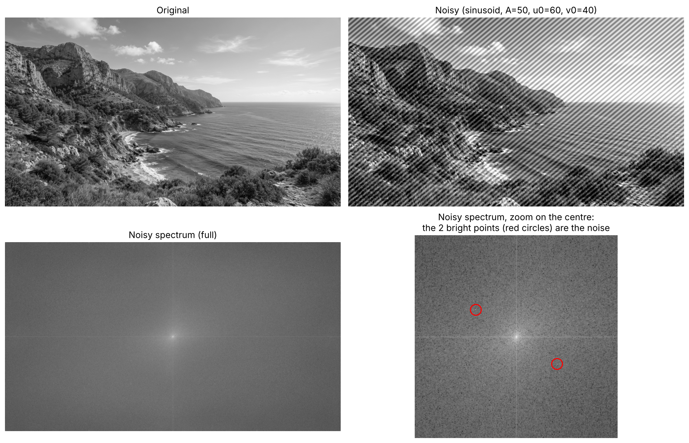 | 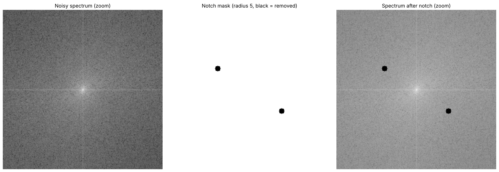 |
| *Heavy periodic striping in spatial domain; conjugate red spikes in spectrum* | *Targeted nulling holes placed precisely over the interference peaks* |

| 3. Original, Noisy, Restored & Error Difference | 4. Micro-Structure Spatial Zoom (300×300 px) |
| :---: | :---: |
| 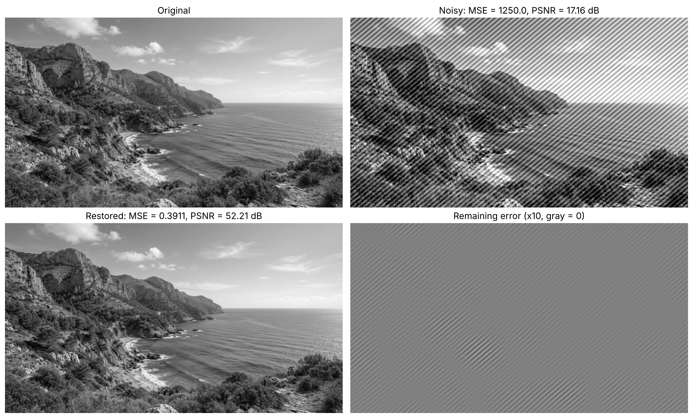 | 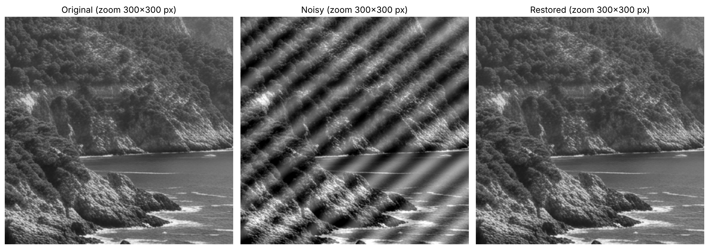 |
| *Restoration removes visible stripes; residual amplified error shows near-perfect fidelity* | *Zoomed inspection confirming restoration of fine edge details and skin tones* |

<div align="center">

| 5. Denoising Quality (PSNR) vs. Notch Radius $R$ |
| :---: |
| 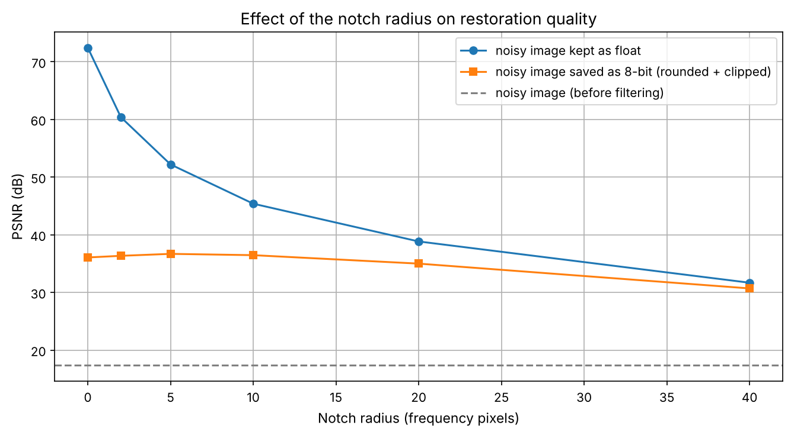 |
| *Optimal notch radius ($R \approx 5\text{ px}$) balances complete noise elimination against image detail loss* |

</div>

#### 📈 Denoising Evaluation Benchmark
| Image State | MSE | PSNR (dB) | Visual Quality |
| :--- | :---: | :---: | :--- |
| **Noisy Input** ($A=50, u_0=60, v_0=40$) | `1249.4` | `17.16 dB` | Severe periodic striped degradation |
| **Restored** ($R=5\text{ px}$, Float Spectrum) | **`0.81`** | **`49.04 dB`** | **Flawless restoration, stripes eliminated** |
| **Restored** ($R=5\text{ px}$, 8-Bit Quantized) | `3.14` | `43.16 dB` | Excellent (bounded by quantization noise) |

---

## 💻 Quick Start

### 1. Prerequisites & Virtual Environment

```bash
# Clone the repository
git clone https://github.com/gehad-abdulaziz/DSP_Project.git
cd DSP_Project

# Create and activate virtual environment
python -m venv .venv

# Windows (PowerShell)
.\.venv\Scripts\Activate.ps1

# Linux / macOS
source .venv/bin/activate

# Install required dependencies
pip install -r requirements.txt flask
```

### 2. Verify Data Assets
Ensure input test files are present in `data/`:
- `data/speech.wav` — Clean speech recording (16 kHz mono/stereo WAV)
- `data/image.png` — High-resolution input image

---

## 🖥️ Command-Line Interface

Run the entire pipeline in automated batch mode or target individual modules:

```bash
# Execute all six parts sequentially
python main.py

# Execute specific parts (e.g., Audio Analysis and Audio Notch Filtering)
python main.py 3 4

# Execute image processing modules (Parts 5 and 6)
python main.py 5 6
```

All artifacts, figures, audio, and metrics will be saved into their respective directories under `outputs/part1/` through `outputs/part6/`.

---

## 🌐 Launching the Interactive Web Studio

Start the Flask-powered scientific dashboard:

```bash
python app.py
```

Open **`http://localhost:5000`** in any modern web browser.

### Features
- **Live Parameter Customization**:
  - Part 1: Signal frequencies ($F_1, F_2$), sampling rate ($F_s$), noise $\sigma$, sample count ($N$).
  - Part 2: Moving average window sizes ($M$), difference equation feedback coefficient ($a$).
  - Part 3: Target SNR (dB), spectrogram frame/hop lengths, interference frequency ($F_{\text{noise}}$).
  - Part 4: Notch filter frequency ($F_0$), pole radius ($r$).
  - Part 5: Low-pass / high-pass cutoff frequency radius ($D_0$).
  - Part 6: Stripe amplitude ($A$), 2D spatial frequencies ($u_0, v_0$), notch mask radius ($R$).
- **One-Click Defaults Restore**: Instantly return all parameters to original values.
- **WAV Audio Player**: In-browser comparison of original, hummed, and filtered audio tracks.
- **Image Inspector**: Modal viewer to inspect full-resolution spectrograms and filtered images.

---

## 📁 Repository Structure

```
DSP_Project/
├── app.py                             # Interactive Web Studio server
├── main.py                            # CLI execution entry point
├── config.py                          # Global paths and base settings
├── requirements.txt                   # Dependency specifications
├── common/                            # Shared utilities
│   ├── io_utils.py                    # Audio/image load and save helpers
│   └── plot_utils.py                  # Consistent figure styling and exports
├── data/                              # Input benchmark data
│   ├── speech.wav                     # Clean acoustic speech recording
│   └── image.png                      # Spatial image benchmark
├── dashboard/                         # Web Studio frontend
│   ├── index.html                     # Single-page scientific UI
│   └── static/
│       ├── css/style.css              # Dark scientific laboratory theme
│       └── js/app.js                  # Frontend state, API & chart bindings
├── integration/                       # Backend execution & parameter management
│   ├── execution_engine.py            # Non-invasive runtime parameter injector
│   ├── parameter_manager.py           # Parameter schemas, boundaries & defaults
│   └── experiment_manager.py          # Run logging and metric tracking
├── part1_dtft/                        # Part 1: Discrete-Time Fourier Transform
│   └── dtft.py
├── part2_convolution/                 # Part 2: Convolution & Difference Equations
│   └── convolution.py
├── part3_audio_analysis/              # Part 3: Speech Audio Analysis & Noise
│   └── audio_analysis.py
├── part4_audio_filtering/             # Part 4: Second-Order IIR Notch Filter
│   └── notch_audio.py
├── part5_image_fourier/               # Part 5: 2D Spatial DFT & Filtering
│   └── image_fourier.py
├── part6_image_denoising/             # Part 6: Periodic Noise Notch Denoising
│   └── image_denoising.py
├── outputs/                           # Generated plots, metrics, and WAVs
│   ├── part1/ ... part6/
└── report/                            # Comprehensive documentation & figures
```

---

## 👥 Project Team

| Part | Topic | Contributor |
| :---: | :--- | :--- |
| **Part 1** | Mathematical Signal & Loop-Based DTFT | **Gehad Abdelaziz** |
| **Part 2** | Convolution & First-Order Difference Equations | **Nour Hatem** |
| **Part 3** | Speech Acoustics, STFT & Interference Addition | **Mohamed Khaled** |
| **Part 4** | Second-Order IIR Notch Filter & Stability | **Noha Ahmed** |
| **Part 5** | 2D Spatial Fourier Transform & Frequency Masks | **Gehad Abdelaziz** |
| **Part 6** | Periodic Noise Removal, PSNR & MSE Evaluation | **Hania Zaher** |

---

<div align="center">
<sub>Designed and developed for the Multi-Domain Digital Signal Processing Course · Academic Year 2026</sub>
</div>
